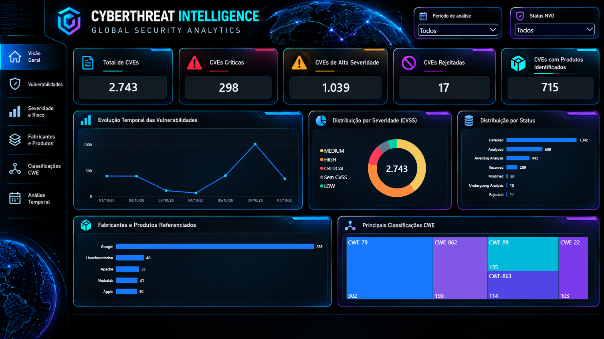
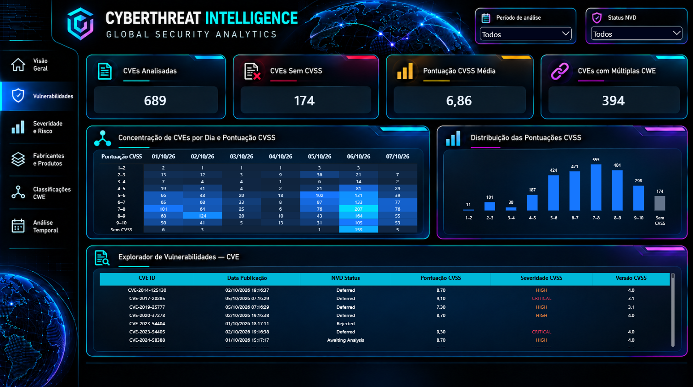
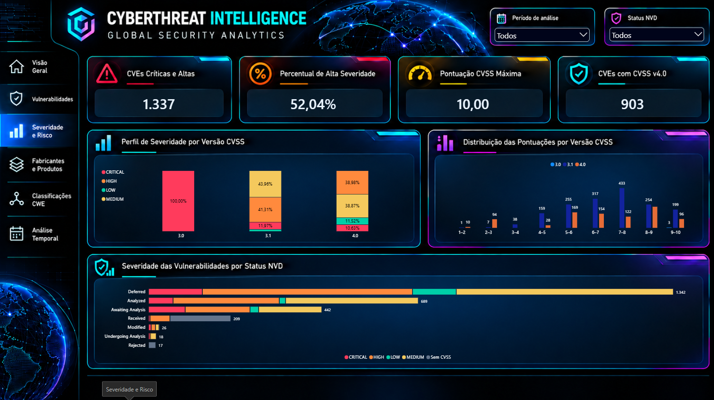
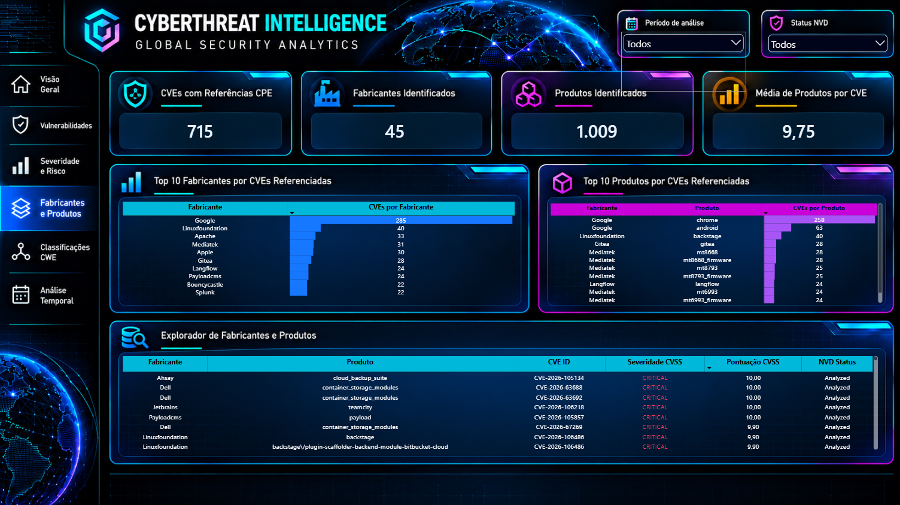
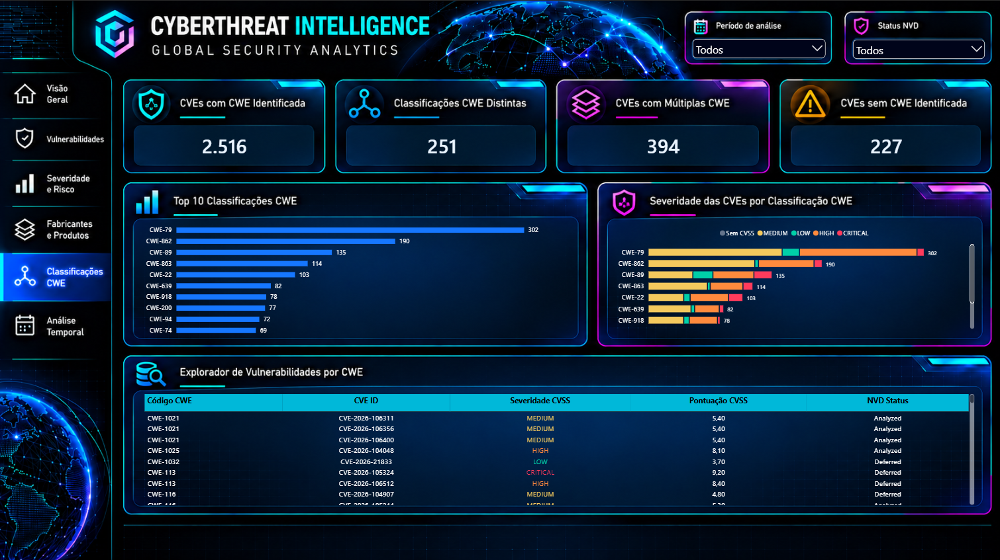
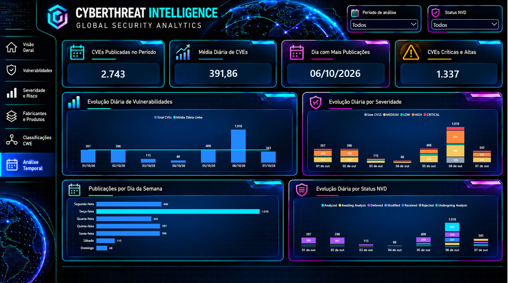

# CyberThreat Intelligence | Global Security Analytics

### Inteligência analítica aplicada à cibersegurança

Projeto de Engenharia de Dados e Business Intelligence desenvolvido para transformar registros públicos de vulnerabilidades em informações estruturadas, indicadores de risco e visualizações interativas.

A solução integra **Python, modelagem dimensional e Power BI**, utilizando dados oficiais do **National Vulnerability Database (NVD)**, mantido pelo NIST.

O objetivo é explorar padrões de vulnerabilidades divulgadas, classificações de severidade, fabricantes e produtos associados, fraquezas de segurança (CWE) e comportamento temporal dos registros.

---

## Visão geral

A crescente quantidade de vulnerabilidades divulgadas exige processos confiáveis de coleta, tratamento e análise de dados.

O CyberThreat Intelligence foi desenvolvido para demonstrar como técnicas de Engenharia de Dados e Analytics podem apoiar a exploração dessas informações, transformando registros técnicos em indicadores acessíveis.

O projeto contempla:

- Coleta automatizada de dados públicos por API.
- Validação da integridade e qualidade dos registros.
- Tratamento e padronização dos dados com Python.
- Arquitetura de dados em camadas Bronze, Silver e Gold.
- Modelagem dimensional para análises no Power BI.
- Construção de indicadores e medidas DAX.
- Dashboard interativo com seis páginas analíticas.

## Base de dados

**Fonte principal:** NIST National Vulnerability Database (NVD)

**API:** CVE API 2.0

**Período analisado:** 1º a 7 de outubro de 2026, considerando a data de publicação dos registros.

**Escopo:** vulnerabilidades publicadas no período selecionado, conforme os registros disponibilizados pela NVD.

### Indicadores da base analisada

| Indicador | Resultado |
|---|---:|
| CVEs distintas | 2.743 |
| CVEs com pontuação CVSS | 2.569 |
| CVEs sem pontuação CVSS | 174 |
| CVEs classificadas como críticas | 298 |
| CVEs classificadas como altas | 1.039 |
| CVEs com classificação CWE | 2.516 |
| Fabricantes identificados | 45 |
| Produtos identificados | 1.009 |

Os indicadores refletem o conjunto de dados e as regras de transformação adotadas neste projeto. Não representam a totalidade das vulnerabilidades existentes.

## Arquitetura de dados

O pipeline utiliza uma organização em três camadas:

**Bronze — Dados brutos**

Armazenamento dos registros originalmente obtidos da API NVD, preservando a estrutura de origem e permitindo rastreabilidade e auditoria.

**Silver — Dados tratados**

Padronização, limpeza, validação e organização dos atributos necessários às análises, incluindo datas, classificações, pontuações e associações.

**Gold — Modelo analítico**

Preparação de tabelas fato, dimensões e tabelas ponte para consumo no Power BI, com foco em integridade referencial, granularidade e consistência dos indicadores.

## Tecnologias utilizadas

| Tecnologia | Aplicação |
|---|---|
| Python | Coleta, auditoria, tratamento e validação |
| Pandas | Manipulação e transformação de dados |
| API REST | Integração com a NVD |
| Power BI | Modelagem e visualização analítica |
| DAX | Construção de medidas e indicadores |
| Git e GitHub | Versionamento, documentação e publicação |

## Dashboard analítico

O dashboard foi organizado em seis páginas:

**01 — Visão Geral**

Indicadores consolidados e panorama das vulnerabilidades registradas no período.

**02 — Vulnerabilidades**

Exploração dos registros CVE e seus principais atributos.

**03 — Severidade e Risco**

Distribuição das classificações CVSS, pontuações e indicadores de severidade.

**04 — Fabricantes e Produtos**

Análise dos fabricantes e produtos identificados nas referências estruturadas da NVD.

**05 — Classificações CWE**

Exploração das categorias de fraquezas de segurança associadas às vulnerabilidades.

**06 — Análise Temporal**

### Visualização do dashboard

#### 01 — Visão Geral

#### 02 — Vulnerabilidades

#### 03 — Severidade e Risco

#### 04 — Fabricantes e Produtos

#### 05 — Classificações CWE

#### 06 — Análise Temporal

Evolução diária das publicações, distribuição por status NVD e identificação de concentrações temporais.

## Qualidade e validação dos dados

O projeto inclui procedimentos de auditoria para verificar:

- Integridade da coleta paginada.
- Unicidade dos identificadores CVE.
- Consistência estrutural dos registros.
- Disponibilidade e classificação das métricas CVSS.
- Ausência de associações duplicadas nas tabelas ponte.
- Integridade referencial das associações CVE–CWE e CVE–Produto.
- Unicidade das chaves dimensionais.
- Continuidade da dimensão calendário.
- Consistência de medidas e filtros utilizados no dashboard.

## Limitações e interpretação

Os registros analisados representam **vulnerabilidades divulgadas**, não ataques executados ou incidentes de segurança confirmados.

A severidade CVSS expressa características técnicas da vulnerabilidade, mas não equivale, isoladamente, ao risco operacional de uma organização.

A presença de fabricantes e produtos depende das informações estruturadas disponibilizadas pela fonte. Portanto, ausência de associação não significa necessariamente ausência de produtos afetados.

As conclusões devem ser interpretadas considerando o período analisado, a disponibilidade dos campos e as regras de tratamento utilizadas.

## Fonte oficial

- [NIST — National Vulnerability Database](https://nvd.nist.gov/)
- [NVD — Documentação da API CVE 2.0](https://nvd.nist.gov/developers/vulnerabilities)
- [MITRE — Common Weakness Enumeration](https://cwe.mitre.org/)
- [FIRST — Common Vulnerability Scoring System](https://www.first.org/cvss/)

---

**CyberThreat Intelligence | Global Security Analytics**

*Projeto de portfólio em Engenharia de Dados, Data Analytics e Business Intelligence.*